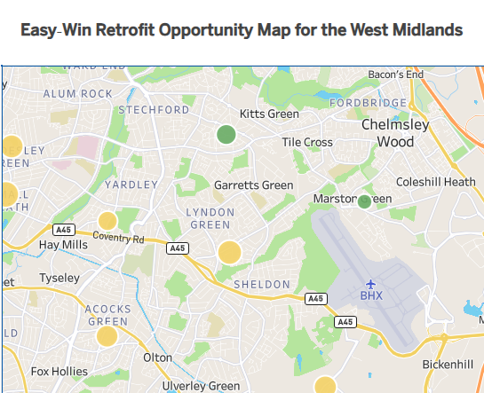
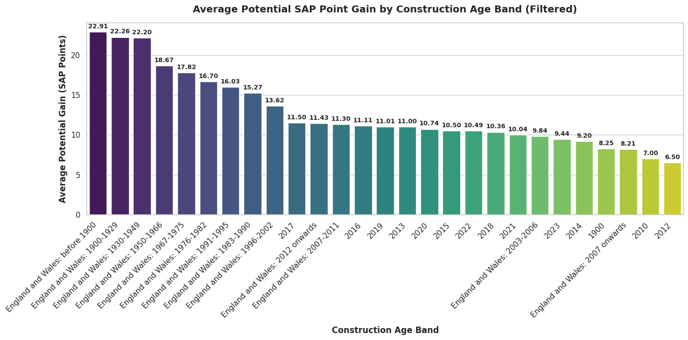

# 

# Energy performance certificate data analysis across The Midlands

An EPC is an energy certificate for a property in England, Wales or Northern Ireland. This includes homes, business properties and public buildings.

The certificate is a standardised document that rates a property’s energy efficiency on a scale from A (most efficient) to G (least efficient). It provides an estimate of typical energy costs, details the property's environmental impact, and outlines actionable recommendations to improve efficiency and reduce carbon emissions. In many countries, including the UK, an EPC is legally required whenever a building is constructed, sold, or rented, and remains valid for 10 years.

The UK government is legally bound to achieve Net Zero greenhouse gas emissions by 2050. Because residential heating and electricity account for roughly 20% of the UK's total carbon emissions, upgrading home energy efficiency is critical to meeting statutory carbon budget targets. Initiatives like the Warm Homes Plan and stricter Minimum Energy Efficiency Standards (MEES) aim to decarbonize housing and strengthen national energy security.

For homeowners and renters, higher efficiency translates directly to lower monthly utility bills. Better insulation, efficient heat sources, and smart controls reduce wasted energy, protecting household budgets from price volatility in global fuel markets

## Aims

In this data analysis project the aim is to identify and visualise the low‑cost, high‑impact improvements that could help the government make visible progress on energy efficiency and carbon reduction through EPC‑based interventions. By focusing on ‘easy‑win’ upgrades—such as improving windows or loft insulation in semi‑modern homes—the government can demonstrate responsible action, achieve measurable gains, and defer more expensive or uneconomical decisions, such as major structural upgrades or demolition, to a later stage. A ‘lead‑by‑example’ approach allows the government to offer limited incentives and grants that demonstrate visible action without placing heavy demands on the public purse. Once these low‑cost improvements are showcased, wealthier private housing groups can be encouraged to follow suit and upgrade the remaining stock.

# Dataset

The dataset is Kaggles EPC ratings England July 2023, the database is publically available and is one of the richest data on individual residential properties. Because the national EPC dataset is extremely large and complex, restricting the analysis to the Midlands represents a sound data‑governance choice. This controlled scope improves data accuracy, reduces noise, and ensures the resulting analytics and machine‑learning models remain reliable and responsibly managed.
The Midlands covering Coventry and Birmingham postcode city area for demonstration purposes due to practicality with the current hardware resource constrains. Also my chosen property set is 'Houses' so not to get overly complex and have clear target recommendations which can be expanded and adapter later.  
The aim of this project is to use advanced data analysis to demonstrate mining the data for possible actions. Using the feature available through Python library to communication the data and to dicuss the Ethical practice that also need to be considered.

# Business Requirements

Targeted Retrofits: Maximizing Government Grant Impact on Regional EPCs
This dashboard helps policy makers answer a critical question: Where and how should we allocate retrofit funding for maximum impact? By evaluating building age, property usage, and regional density, the tool determines the single upgrade that generates the highest EPC score gain per pound spent. Users can adjust an interactive budget slider to model cost estimates and identify the ideal target areas for government-funded campaigns for houses with very low EPC ratings.

# Planning

Project Planning board over days 1-4 on interactive Kanban board for tracking my project progress and essuring goals and targets met.
https://github.com/users/john8647/projects/8

# Ethical consideration.

So what are the consideration, knowing that in this public dataset there is no personal data, so no GDPR or sensitive data is stored. Property information is private. But The Country has governance over it for pratical and political reasons. So we have to consider property‑level information, which creates indirect ethical concerns around how the data could be interpreted, repurposed, or used in ways that affect people or communities. The residents could be subject to unfair commercial targeting as EPC‑related features (age, insulation, heating type, efficiency) can be used to: identify neighbourhoods with older, colder homes and target those areas with aggressive sales campaigns.
Property upgrades can be expensive and if there is the potential to push expensive upgrades or exploit households with limited income it could lead to hardship.
This is a form of data‑enabled commercial pressure, not a privacy breach its just can be used in a way which is unfair or manipulative.
The dataset includes: fields property age, heating system, insulation, glazing, efficiency rating and location.
These features correlate strongly with: income, deprivation, rental vs owner‑occupied status likelihood of fuel poverty. So it can indirectly make implication. Then could lead to profiling an entire neighbourhoods which is ethically sensitive.
The dataset can unintentionally reinforce thinking like
“older homes are worse and therefore morally responsible for emissions”
“certain regions contribute more to carbon output”
“homeowners should bear the cost of upgrades”

But carbon responsibility is not evenly distributed — it’s shaped by:

- historical building standards
- landlord behaviour
- regional investment
- national policy
- global supply chains

Bias in Housing Stock Representation.
Also consider that some regions have more EPC‑recorded properties, this may be due to the nature of renting in the area and how local policy recommendations are enforced.
Also older homes may be over‑represented while rural areas may be under‑represented
In some areas rental properties may appear more frequently.

This affects:

- regression accuracy
- clustering patterns
- fairness of conclusions
- policy recommendations

Misinterpretation and Overgeneralisation
A model trained on EPC features might lead people to:

- assume a home is “poor quality”
- assume a neighbourhood is “low income”
- assume certain homes are “high risk”
- make unfair comparisons between regions
- assume an increase in renting in an area will directly increase carbon emissions.

Misinterpretation of EPC‑related property data may distort housing market perceptions, potentially lowering the sale price of older homes or inflating the value of newer ones, thereby reducing affordability for prospective buyers.

So we have to consider some of these as risks relating to socioeconomic profiling, unfair commercial targeting, and misinterpretation of carbon responsibility.

## Hypothesis and how to validate?

**Hypothesis 1 ($H_1$)**: 'Houses': that already have insulated walls but weaker secondary features (e.g. older windows, low loft insulation or poorly efficent heating) represent a cost‑effective “easy win” for improving EPC ratings compared to homes needing expensive wall insulation upgrades.

How to prove this? First identify the group with a significant single feature
Filter properties that match: e.g. Semi‑modern age band:  
Label: properties built roughly between 1965–2000
Insulated walls present: Label: cavity wall insulation or internal/external wall insulation already installed. With a single or older double glazing and or with
low loft insulation thickness and or with older or poor heating system or controls.
Will give us : “semi‑modern, structurally decent, but with weaker secondary features.”
Compare potential EPC improvement vs cost Use EPC recommendation fields (if available) or typical upgrade assumptions:
For your target group: model EPC rating before upgrades simulate upgrades: better windows, improved loft insulation and estimate EPC rating after upgrades.
Use approximate cost (using standard cost bands from EPC guidance or literature)
For older, poorly insulated homes: simulate wall cladding / major insulation upgrades
estimate EPC rating improvement and approximate cost.

Then compare:
EPC gain per £ spent by the Number of homes in each group.
Total potential carbon reduction per £
If the hypothesis is right, the semi‑modern group will show higher EPC improvement per unit cost.
We can use clustering to support the story. We can complare (e.g. k‑means) on:
age band / wall insulation status / window type / loft insulation and
the current EPC rating.

## Section 1 - Exploring features that relate to energy.

We Identified from the data where results of "Poor" or "Very_Poor" these when related to either the walls, roof, windows or mainheating would result in a low score. Almost half is caused by poor wall insulation. Suggesting energy loss through the wall is the highest factor to a low EPC rating.

## Section 2 - Potential SAP Point Gain

Once an EPC assessment is complete, assessors highlight key upgrades to boost the rating. The SAP (Standard Assessment Procedure) each count as a point towards to final score. Through analytical modeling, we can single out the most effective feature to deliver the biggest performance jump. By evaluating high-impact measures like window upgrades, wall insulation, or loft insulation, we can isolate the single most effective improvement. Applying this targeted upgrade across a specific housing group clearly demonstrates its power to elevate EPC scores.

## Section 3 - Application

The application brings together the skills I’ve learned throughout the course at the Codeing Institute to create a practical dashboard and interactive demonstration that showcases my findings in a hands‑on, accessible way and for others to see how data can be displayed both as a story and as an app.

## Published Dashboard

This map shows where homes in the West Midlands have the best potential for low‑cost energy‑efficiency improvements. Each circle represents a group of homes in a small geographic area. The colour of the circle shows how attractive the improvement opportunity is:
Green = strong “easy win”
(big improvement in EPC rating for relatively low cost)
Yellow = moderate opportunity
Red = weaker opportunity
(smaller improvement or higher cost)
The size of each circle shows how many homes in that area meet the criteria for improvement.
Large circles mean many homes could benefit; small circles mean only a few.
In short:
Colour = quality of opportunity  
Size = number of homes affected

The map showing the results can be viewer here.
https://public.tableau.com/views/EasyWinRetrofitOpportunityMapfortheWestMidlands/Sheet1?:language=en-GB&:sid=&:redirect=auth&:display_count=n&:origin=viz_share_link

# Interpretation (what you should notice and what you can do about it)

Green clusters highlight neighbourhoods where retrofit upgrades are both affordable and effective, making them ideal targets for local authorities, landlords, or energy‑efficiency programmes.

Yellow and red areas still have improvement potential, but the upgrades may be more expensive or deliver smaller EPC gains.

Large circles indicate high‑impact zones where many homes share similar improvement needs — useful for planning bulk interventions or community‑scale retrofit schemes.

Government energy grants are targeted, meaning deployment strategy is just as critical as the upgrade itself. Our tool not only identifies the single most impactful feature to upgrade (windows, walls, or roof insulation), but also maps where to apply it. By segmenting housing and demographic datasets, we enable grant administrators to pinpoint target groups and maximize campaign outcomes.

In Birmingham Lea Hall area shows up as green because the homes there have a high Easy‑Win Index — meaning they can gain a good number of SAP points for relatively low retrofit cost. But the green circle is small, which tells us the opportunity is limited to a small number of homes.
Colour = quality of opportunity.
Lea Hall = high‑quality, low‑cost upgrades.
Size = scale of opportunity therefore Lea Hall has a small number of homes needing attention.

# 

Each circle represents the centre point of a postcode area. The size of the circle shows how many homes fall into the category most in need of EPC improvement, while the colour—from red (high) to green (low) indicates the average estimated cost of retrofit upgrades in that area.
A practical application of this mapping work is to help local authorities, housing associations, or community energy groups target support where it will have the greatest impact. By identifying clusters of homes with low EPC ratings and high potential for improvement, organisations can plan outreach activities more efficiently.

For example, areas with a high concentration of “easy‑win” properties could be prioritised for local engagement events, where residents receive advice on insulation, glazing upgrades, or available government grants. These targeted events reduce wasted effort and ensure that support reaches households most likely to benefit.

Similarly, the maps could guide retrofit programme planning, helping councils decide where to deploy surveyors, energy assessors, or contractors. Instead of blanket campaigns across an entire region, resources can be focused on neighbourhoods where improvements are both cost‑effective and likely to deliver meaningful EPC gains.

The analysis also supports long‑term housing strategy, highlighting areas where older or inefficient housing stock may require deeper investment. This can inform funding bids, community retrofit schemes, or partnerships with developers and social landlords.

Overall, the mapping provides a data‑driven foundation for targeted, efficient, and impactful energy‑efficiency interventions, ensuring that limited resources are directed to the homes and communities where they will make the biggest difference.

## Hands on Demo for educational purposes

https://epc-midlands-7083ec783bd2.herokuapp.com/

The link above opens the interactive Heroku dashboard that demonstrates my EPC machine‑learning model in action.
Users can enter details from their own home and instantly see the predicted EPC potential score, the likely rating improvement, and an estimated retrofit cost.
If you already know your current EPC rating, the tool gives a quick indication of how close the model’s prediction is to your official certificate.
If you don't have one already or its older than 10 years; apply to arrange one here https://www.localsurveyorsdirect.co.uk/energy-performance-certificates-epc
(I have no links to the surveyors being promoted on this site)

## Compare Hypotheses with findings

# 

This bar chart illustrates how much a typical house can improve its energy efficiency rating based on the period it was built. Here is a breakdown of what the key components and trends show:

The Vertical Axis (Y-axis - Average Potential Gain): Represents the average increase in Standard Assessment Procedure (SAP) points. SAP points measure the energy performance of a dwelling (usually on a scale from 1 to 100). A higher value on this axis means that houses in that category have a much larger headroom for energy-efficiency improvements.
The Horizontal Axis (X-axis): Lists the different construction eras or years (CONSTRUCTION_AGE_BAND) recorded for the houses.
The Core Trend (Older vs. Newer Homes):
Oldest Homes (Left side): Homes built before 1900, or in the early 20th century (1900-1949), show the highest potential gain (over 22 SAP points). These homes typically started with poor insulation (such as solid stone/brick walls, single glazing) and outdated heating systems, making them prime candidates for significant upgrades.
Newer Homes (Right side): As we move to the right, the potential gain progressively drops. Homes built after 2010 generally show potential gains of around 7 to 11 SAP points. Since modern building codes require double glazing, cavity insulation, and efficient heating upon construction, these newer homes are already highly efficient and have less room for drastic improvement.
The Color Gradient (Palette): The colors shift from dark purple (highest potential gain) to bright yellow/green (lowest potential gain) to draw your eye immediately to the age bands where retrofitting yields the most significant impact.

## Practical challenges in executing the project.

During development I encountered significant memory constraints when working with the EPC dataset. The original national EPC dataset is extremely large — around 23GB — and processing it into a Midlands‑only subset still produced a file of approximately 1.2GB. Loading this locally or in cloud notebooks repeatedly was slow and resource‑intensive, so I refined my approach.

To reduce the dataset size, I filtered by postcode prefixes B and CV, which correspond to Birmingham and Coventry. This produced a more manageable subset, but even after cleaning and preprocessing, the final CSV was still 123MB. This exceeded both Heroku’s 512MB RAM limit and GitHub’s 100MB file size limit, meaning I could not deploy the full dataset directly.

To work around this, I uploaded my refined Midlands dataset to Kaggle and created my own hosted dataset. This allowed me to load the data efficiently in cloud environments such as Google Colab, where I performed memory‑heavy tasks including heat‑map correlation analysis and regression chart exploration.

However, Heroku still could not load the full 123MB CSV at runtime. To solve this, I changed my application code so that it only downloads and loads the specific fields required for the dashboard rather than the entire dataset. By restricting the columns to only those used in the visualisations and calculations, I reduced memory usage enough for the application to run within Heroku’s limits.

This combination of dataset refinement, selective column loading, and cloud‑based preprocessing allowed me to overcome the memory limitations of both Heroku and GitHub while still delivering the required analysis.
